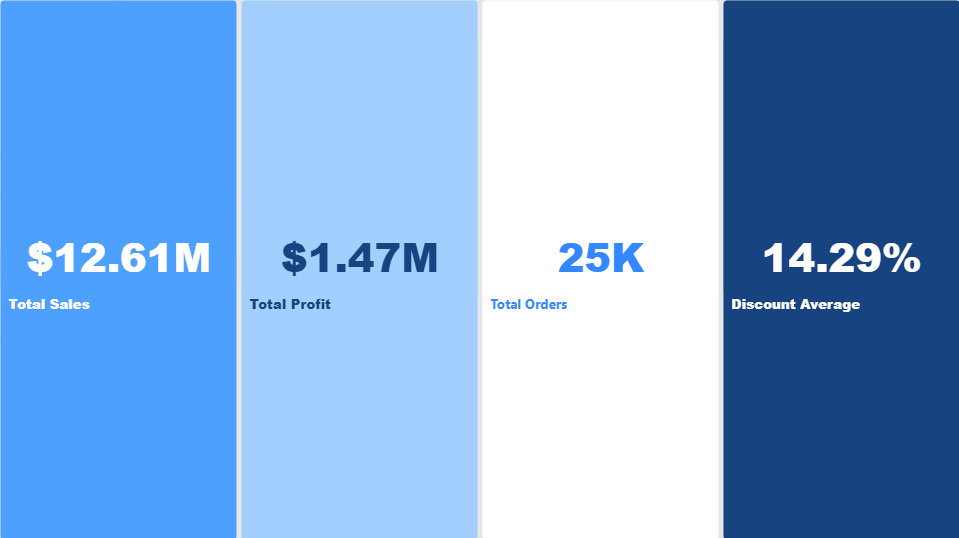

# 📊 E-Commerce Sales Analytics & Business Insights

An end-to-end data analytics project focused on transforming raw sales data into actionable business intelligence using SQL, Excel, and Power BI. This project identifies revenue leakage, evaluates regional performance, and provides data-driven recommendations for profitability optimization.

---

## 📸 Dashboard Preview


*Figure 1: Executive Overview Dashboard Page*

---

## 🎯 Business Problem & Objectives

The primary goal of this analysis is to evaluate sales distribution, regional performance, and shipping efficiency while pinpointing profit-draining operational bottlenecks. 

**Key Objectives:**
- Clean and validate a raw sales dataset of 50,000+ records.
- Conduct advanced SQL queries to analyze customer patterns, product margins, and regional revenues.
- Detect **Revenue Leakage** caused by negative-profit orders and excessive discounting.
- Build an interactive, multi-page Power BI dashboard for executive decision-making.

---

## 🛠️ Tech Stack & Tools

- **Data Cleaning & Prep:** Microsoft Excel / Python
- **Database & Querying:** SQL (PostgreSQL / MySQL / MS SQL Server)
- **Data Visualization & Modeling:** Power BI (DAX, Interactive Slicers, Custom KPIs)
- **Documentation & Version Control:** Git & GitHub

---

## 🔍 Key Findings & Actionable Insights

1. **Regional Dominance:** The **APAC** market emerged as the highest revenue generator, contributing over **$3.5M** to total sales.
2. **Profit Leakage Alert:** Identified **12,518 negative-profit transactions**. Analysis revealed that aggressive discounting strategies heavily eroded gross margins.
3. **Product Performance:** Top-tier products like the *Canon imageCLASS 2200* led in overall profitability, generating over **$25K** in net profit.
4. **Logistics & Shipping:** Standard Class shipping represents the majority of order volume, highlighting opportunities to negotiate bulk freight rates.

---

## 💡 Strategic Recommendations

- **Discount Threshold Caps:** Implement strict limits on maximum allowable discount percentages to eliminate negative-profit orders.
- **APAC Market Expansion:** Allocate additional marketing resources to the APAC region to leverage high demand.
- **Product Portfolio Optimization:** Review pricing structures for underperforming product categories.

---

## 📂 Repository Structure

```text
├── data/           # Raw and processed datasets
├── sql/            # SQL scripts for data extraction & analytics
├── pbix/           # Power BI template/report file (.pbix)
├── excel_sheet/    # Exploratory Analysis
├── screenshots/    # Visual previews of the dashboard
└── README.md       # Project documentation
```

## 👤 Author & Contact

Muhammad Fathi Al-Bahwar

GitHub: [[Click Here](https://github.com/MohamedAlbehwar)]

LinkedIn: [[Click Here](https://www.linkedin.com/in/mohamed-fathy224/)]

Email: [[Contact with Me](mailto:mohamed.fathy.22407@gmail.com)]

If you find this repository helpful, feel free to give it a ⭐️!

